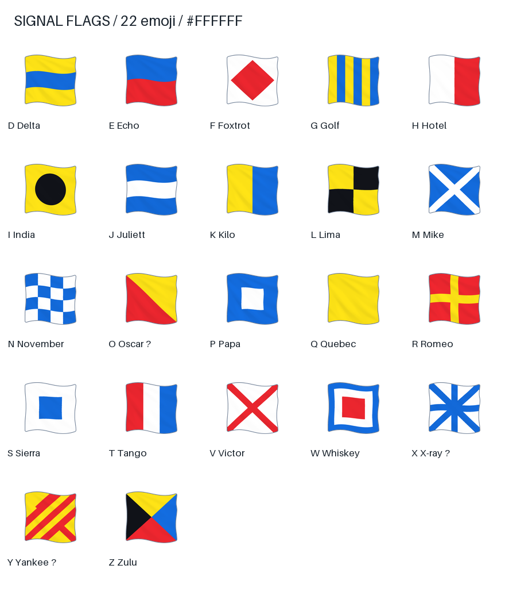
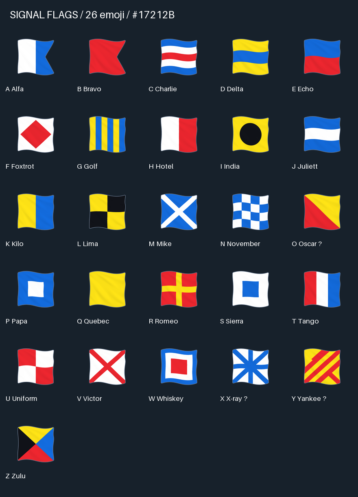

# signal-flags-emoji

[](LICENSE)

26 морских сигнальных флагов из предоставленного архива и добавленных исходников, обработанные для использования рядом с текстом в Telegram. Готовые файлы — **PNG RGBA, 100 × 100 px, sRGB**, с прозрачным фоном и лёгким объёмом. Полотнище занимает до 90 × 90 px, пропорции сохранены.




## Готовые файлы и просмотр

- [emoji/](emoji/) — PNG для загрузки в Telegram **файлами**, без сжатия фотографий.
- [processed/](processed/) — обработанные изображения 1024 × 1024 или 2048 × 2048 px с прозрачностью.
- [Контактный лист на белом](previews/contact-white.png) и [на тёмном](previews/contact-dark.png) — каждый флаг в 20, 24, 32 и 100 px и рядом с текстом при 24 px. Открывайте оригинал изображения в масштабе 100%, чтобы оценить реальные размеры.
- [Сравнения до/после](previews/) — `comparison-01.png` … `comparison-05.png`.
- [Каталог](CATALOG.md), [CSV](catalog.csv), [инструкция Telegram](docs/telegram.md), [отчёт проверки](docs/quality.md).

В наборе все 26 букв A–Z. Обозначения определены по рисунку; 23 изображения определены уверенно; O Oscar (переставлены цвета), X X-ray (добавлен диагональный крест) и Y Yankee (пересекающая полоса) — предположительные варианты, отмеченные знаком `?` на превью и в каталоге. Точная идентификация X не подтверждена. Это обработка предоставленной декоративной графики, а не исправленный нормативный справочник морских сигналов.

## Структура

```text
originals/       исходные байты, имена по буквам
processed/       PNG RGBA в исходном разрешении
emoji/           PNG RGBA 100 × 100
previews/        контактные листы и сравнения
scripts/         обработка, экспорт, настройки каждого флага
scripts/flags.json  каталог исходников, SHA-256, палитра и overrides
docs/            инструкция, описание обработки, результаты проверок
```

Все исходники переименованы по буквам: `a-alfa.jpg`, `b-bravo.jpg` и т. д. Содержимое файлов не изменено. У 22 архивных файлов ранее было ошибочное расширение `.png`, хотя фактический формат — **JPEG RGB**. Расширение `.jpg` теперь соответствует содержимому. Прежние имена сохранены в `catalog.csv` и `scripts/flags.json`; настоящие PNG создаются только в выходных папках. Архив, виртуальное окружение, кеши и временные файлы исключены из Git.

## Повторная сборка одной командой

Нужны Python 3.12+ с `venv`, Bash и доступ к PyPI при первой установке зависимостей. Проверено на Python 3.15 / macOS arm64; версии зависимостей закреплены в `requirements.txt`.

```bash
./scripts/build.sh
```

Команда создаёт `.venv`, устанавливает зависимости, проверяет исходные SHA-256, обрабатывает все изображения, создаёт превью и каталог, затем выполняет проверки экспорта. Исходники уже включены в репозиторий, архив для сборки не нужен. Архивные исходники можно восстановить из `Maritime_Signal_Flags.zip` в корне проекта: поле `archive_member` связывает прежнее имя в ZIP с новым именем. Добавленные отдельно файлы нужно восстановить из репозитория или собственной копии.

Настройки находятся в [scripts/flags.json](scripts/flags.json): общая палитра, ширина и цвет обводки, степень ослабления теней, порог внешнего фона, сглаживание. Поле `settings` каждого флага переопределяет общие значения; например, у India, Whiskey и Zulu объём дополнительно ослаблен. Палитру можно переопределить целиком в `settings.palette`. При добавлении исходника добавьте запись с обозначением, цветами и SHA-256; неизвестный исходник требует явной записи и статуса идентификации.

Метод и ограничения описаны в [docs/processing.md](docs/processing.md). При обработке нейросетевая генерация и новая отрисовка не применяются.

## Лицензия

Весь проект — исходные изображения, обработанные изображения, эмодзи, превью, скрипты, каталоги и документация — опубликован под **CC0 1.0 Universal (CC0-1.0)**.

Полный официальный текст: [LICENSE](LICENSE). [CC0 на сайте Creative Commons](https://creativecommons.org/publicdomain/zero/1.0/).

## Справочник

Для сверки обозначений использован [справочник флагов ВМС Сингапура](https://www.navy.gov.sg/publications-stories/naval-traditions/naval-flags-and-pennants/).
